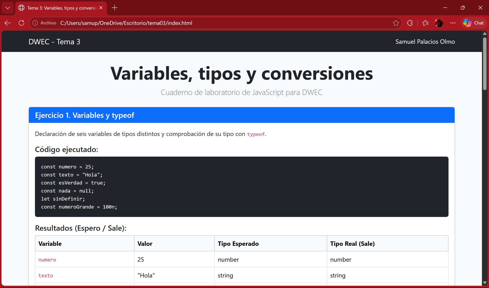
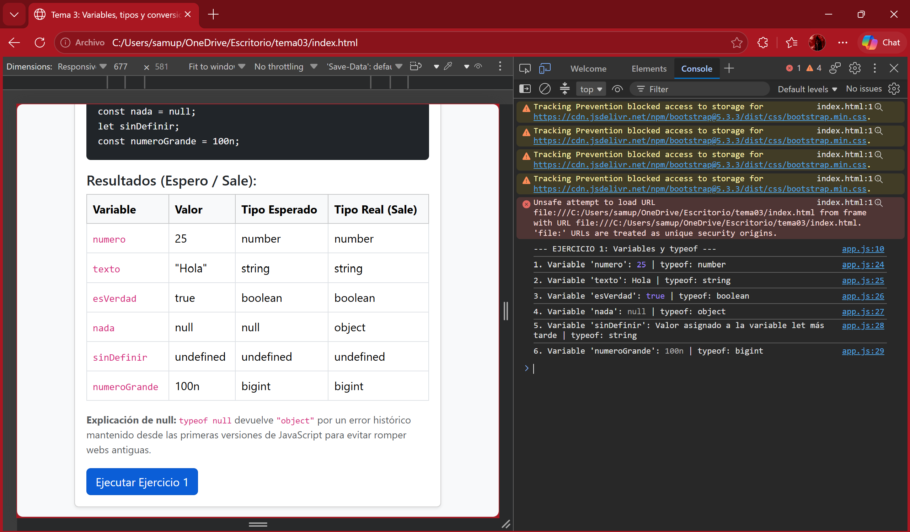
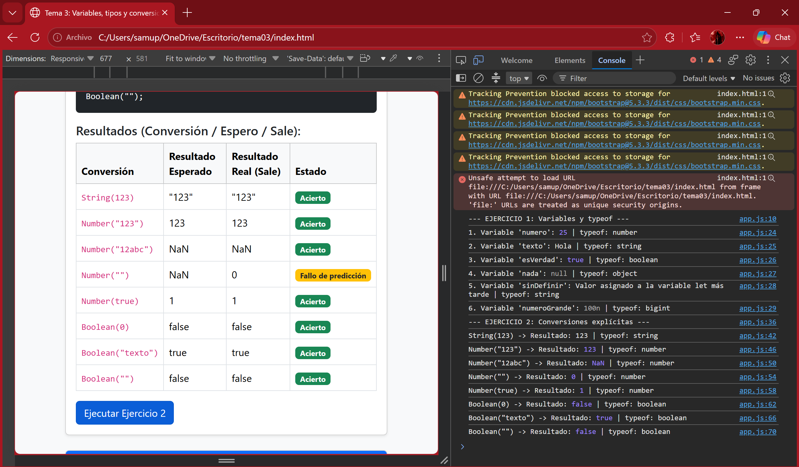
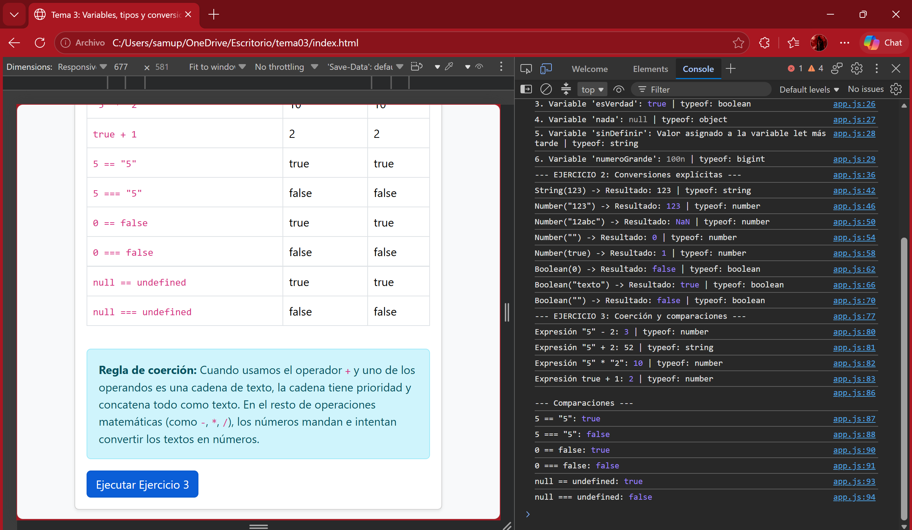
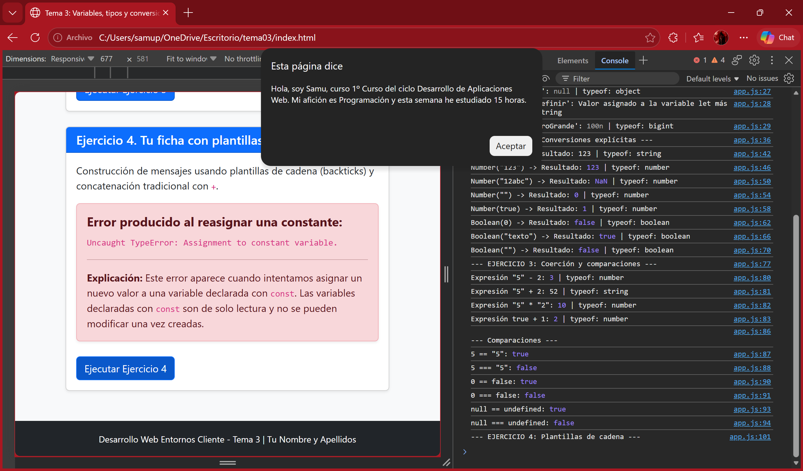

# Tarea 3 · Variables, tipos y conversiones

**Autor:** Samuel Palacios Olmo · Desarrollo Web en Entorno Cliente (DWEC) · 2.º DAW · Curso 2026-27

En esta carpeta se encuentra la práctica correspondiente al Tema 3. Para visualizar el proyecto, abre la carpeta `tema03` en Visual Studio Code, inicia el servidor local con **Go Live** para abrir `index.html` en el navegador, y abre la consola de desarrollador con **F12** para ejecutar la lógica de cada ejercicio mediante sus respectivos botones.

## Capturas

### a) La página entera

En la captura se observa la página web completa con mi nombre (Samuel Palacios Olmo) visible en la barra de navegación superior (navbar) y en el pie de página, junto a las cuatro cards de los ejercicios y los fallos de predicción destacados con etiquetas de Bootstrap.

### b) Consola del ejercicio 1

Se observa la ejecución de la función `ejercicio1()`, mostrando en consola los valores y tipos (`typeof`) de las seis variables declaradas, incluyendo el caso especial de `null` que devuelve `"object"`.

### c) Consola del ejercicio 2

Se muestran las pruebas de conversión explícita usando `String()`, `Number()` y `Boolean()`, comprobando los tipos resultantes frente a las predicciones iniciales planteadas en la tabla del documento.

### d) Consola del ejercicio 3

Se visualizan las operaciones de coerción implícita de tipos (como la diferencia entre `+` y `-` con cadenas) y las comparaciones con igualdad débil (`==`) frente a igualdad estricta (`===`).

### e) Consola del ejercicio 4, con el error de la const

Se muestra la generación del mensaje personalizado con plantillas de cadena (backticks) y la provocación intencionada del error `Uncaught TypeError: Assignment to constant variable.` al reasignar una constante.

## Reflexión

Durante la realización de esta práctica, las conversiones a tipo `Boolean()` y las operaciones matemáticas estándar me han resultado bastante intuitivas. Sin embargo, me han sorprendido varios comportamientos de la coerción implícita en JavaScript. Por ejemplo, la conversión `Number("")` devuelve `0` en lugar de `NaN`, lo cual rompe la intuición inicial de que un texto vacío no debería tener representación numérica. Asimismo, la diferencia de comportamiento con el operador `+` (que concatena como texto `"5" + 2 = "52"`) respecto a la resta (que convierte a número `"5" - 2 = 3`) demuestra la importancia de usar conversiones explícitas y la comparación estricta (`===`) para evitar errores sutiles en el código.

## Fuentes

- [MDN Web Docs - typeof](https://developer.mozilla.org/es/docs/Web/JavaScript/Reference/Operators/typeof)
- [MDN Web Docs - Coerción de tipos](https://developer.mozilla.org/es/docs/Glossary/Type_coercion)
- [Plantilla original del repositorio de DWEC (DRodero)](https://github.com/DRodero/DWEC_2627)

## Uso de IA

Se ha utilizado la herramienta **Gemini** como apoyo pedagógico para:
1. Comprender la estructura de proyectos y control de versiones con Git/GitHub.
2. Formatear y redactar adecuadamente la documentación en formato Markdown (`README.md`).
3. Analizar y revisar los tipos de datos en JS para argumentar las reflexiones sobre la coerción.

Todo el código e información proporcionada por la IA fue revisado, probado en la consola del navegador y adaptado personalmente a los requisitos de la entrega.