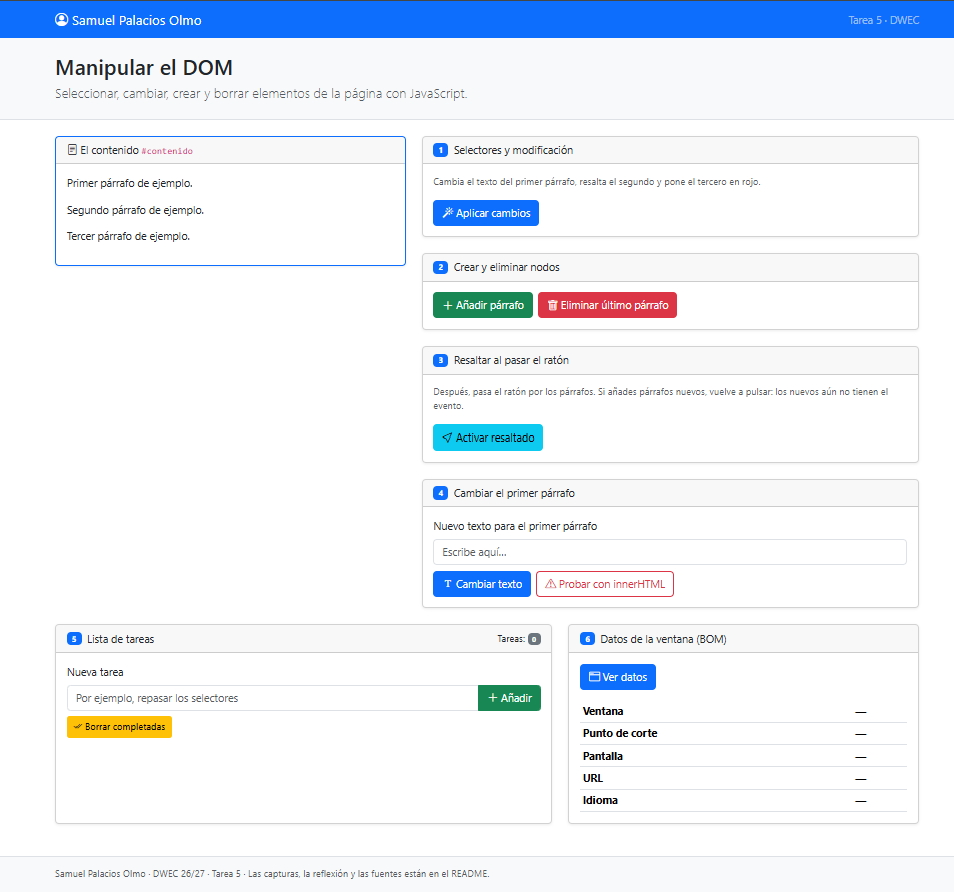
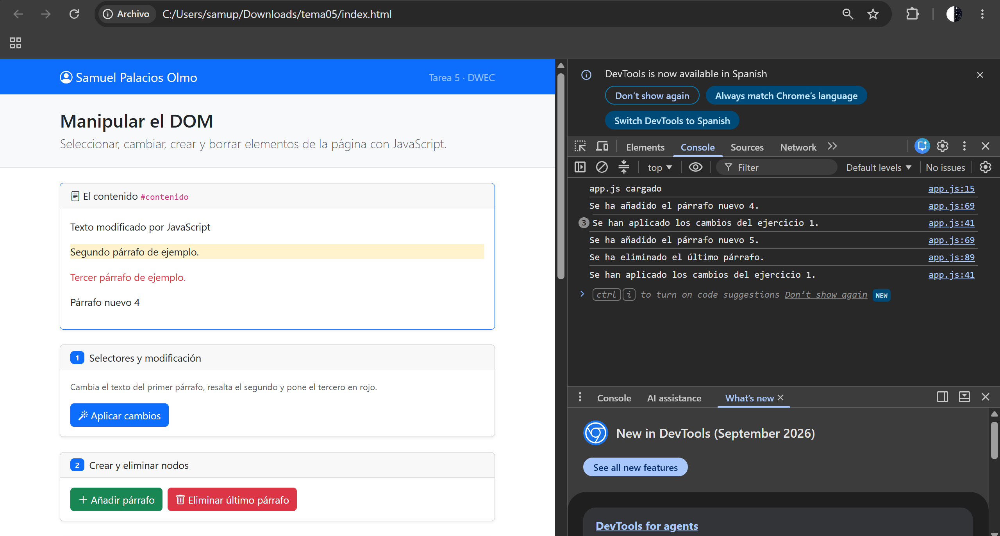
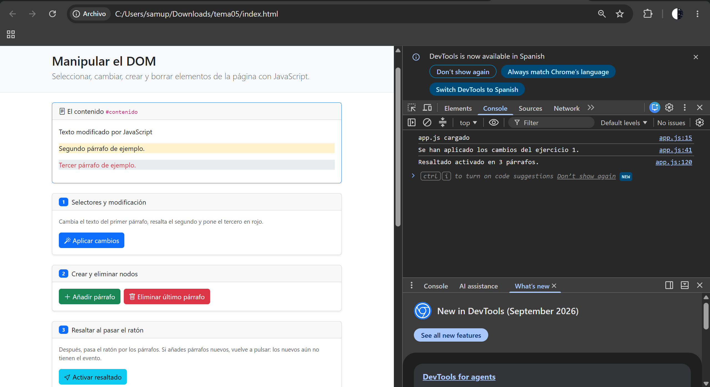
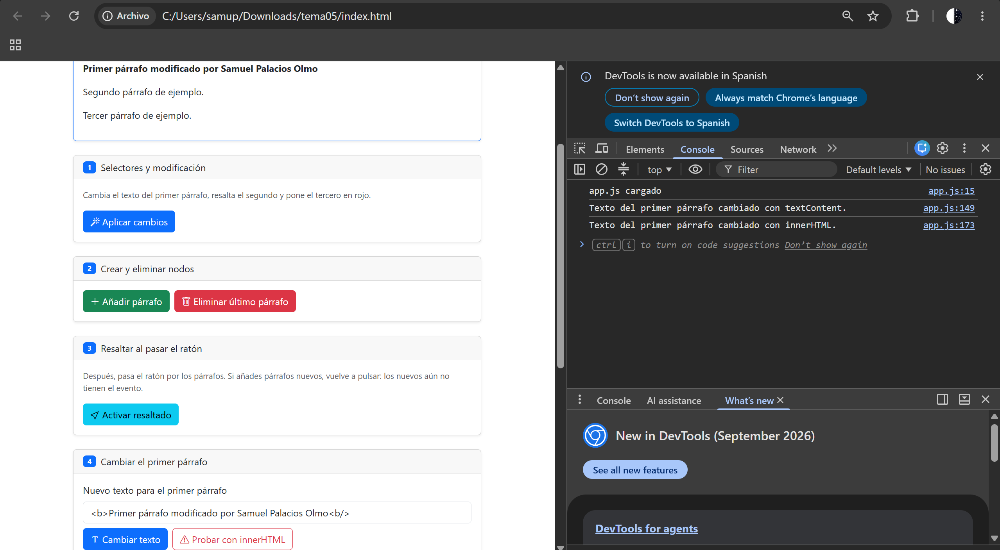
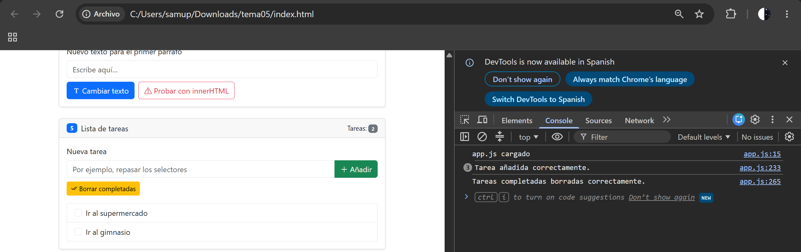
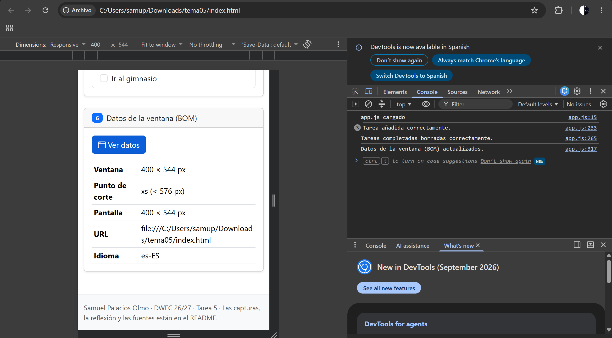

# Tarea 5 · Manipular el DOM

**Autor:** Samuel Palacios Olmo · Desarrollo Web en Entorno Cliente (DWEC) · 2.º DAW · Curso 2026-27

Para probar la práctica, abre la carpeta del proyecto en VS Code, inicia **Live Server** (`Go Live`) y comprueba el funcionamiento de los botones manteniendo la consola del navegador abierta (F12) para ver las trazas de JavaScript.

## Capturas

### a) La página recién cargada

La página recién cargada mostrando el nombre «Samuel Palacios Olmo» en la barra de navegación y los tres párrafos de ejemplo en el contenedor `#contenido`.

### b) Ejercicios 1 y 2

El primer párrafo cambia su texto usando `getElementById("primero")`, el segundo se resalta con `querySelector` y la clase `bg-warning-subtle`, y el tercero se pone en rojo empleando `querySelectorAll("#contenido p")` con su índice. Además, se han añadido dos párrafos nuevos numerados.

### c) Ejercicio 3: resaltado al pasar el ratón

Párrafo resaltado al pasar el ratón por encima mediante los eventos `mouseenter` y `mouseleave`. Los párrafos añadidos posteriormente no tienen este evento activo hasta que se vuelve a pulsar el botón de activar resaltado.

### d) Ejercicio 4: `<b>hola</b>` con innerHTML

Al utilizar `textContent` el texto `<b>hola</b>` se muestra literalmente como caracteres de texto plano. Al usar `innerHTML`, el navegador interpreta la etiqueta HTML, mostrando la palabra **hola** en negrita.

### e) Ejercicio 5: la lista de tareas

La lista de tareas con tres elementos añadidos y uno de ellos marcado con la casilla de verificación antes de pulsar el botón de borrar completadas.

### f) Ejercicio 6: los datos de la ventana en el móvil

Visualización en modo dispositivo móvil desde las herramientas de desarrollo (F12) mostrando el punto de corte adaptado a pantallas pequeñas (`xs` o `sm`) frente al tamaño de escritorio (`xl` o `xxl`).

## Reflexión

La diferencia fundamental entre `textContent` y `innerHTML` radica en cómo procesan el contenido: `textContent` trata todo el valor estrictamente como texto plano, insertando los caracteres de forma literal, mientras que `innerHTML` analiza e interpreta las cadenas como código HTML real. Por esta razón, nunca se debe introducir directamente en `innerHTML` lo que escribe el usuario, ya que supone una grave brecha de seguridad conocida como XSS (*Cross-Site Scripting*). Si un usuario introduce etiquetas o código malicioso, como por ejemplo `<b>hola</b>`, `innerHTML` lo renderizará y ejecutará, permitiendo alterar la interfaz o inyectar scripts en el navegador.

## Fuentes

- [MDN Web Docs: Manipulating documents](https://developer.mozilla.org/es/docs/Learn/JavaScript/Client-side_web_apis/Manipulating_documents)
- [Bootstrap 5.3 Documentation](https://getbootstrap.com/docs/5.3/getting-started/introduction/)

## Uso de IA

- **Herramienta:** Gemini.
- **Para qué se usó:** Para orientarse en la estructura de eventos del DOM, repasar la sintaxis correcta de los selectores y revisar la redacción técnica del README.
- **Qué se hizo después:** Se adaptó, comprobó y probó todo el código paso a paso en el entorno local asegurando el cumplimiento estricto de los requisitos de la tarea.