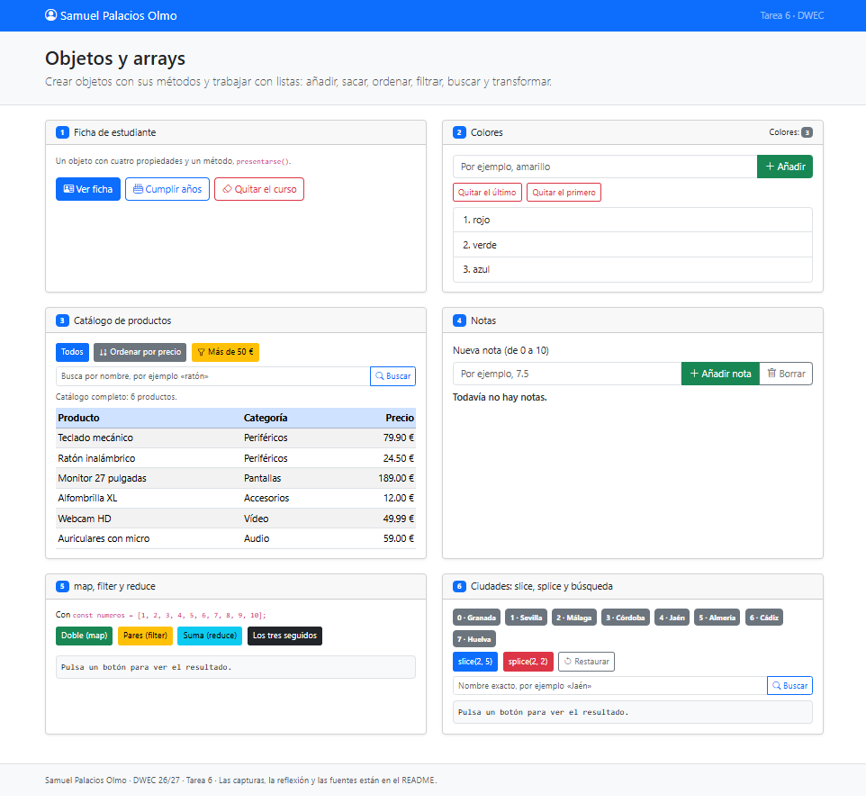
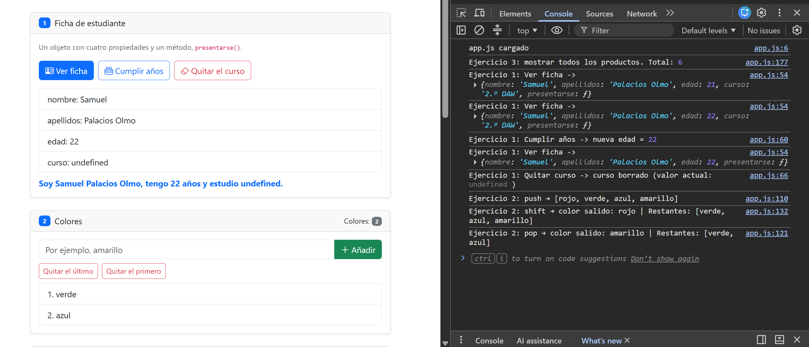
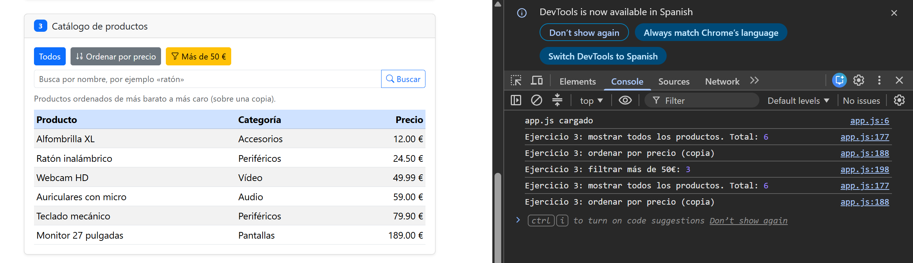
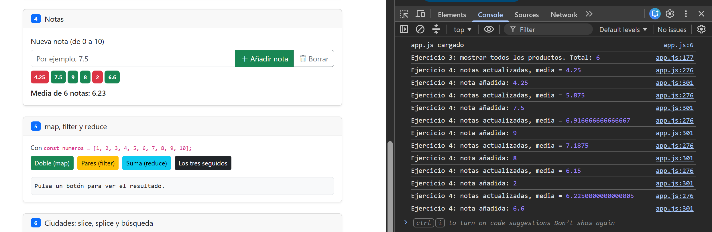
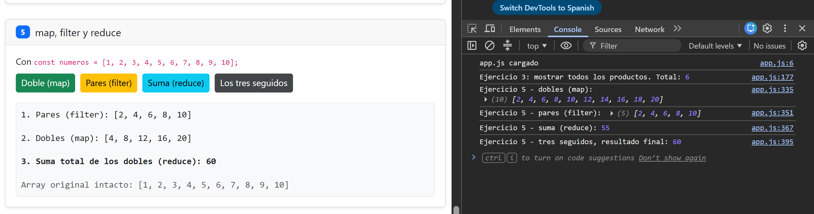
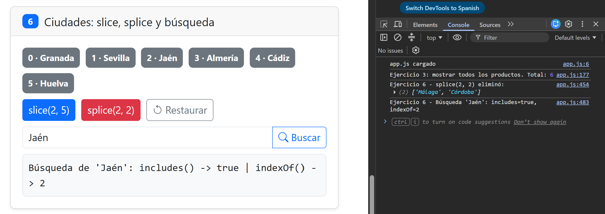

# Tarea 6 · Objetos y arrays

**Autor:** Samuel Palacios Olmo · Desarrollo Web en Entorno Cliente (DWEC) · 2.º DAW · Curso 2026-27

Carpeta que contiene la solución completa de la Tarea 6 de DWEC, estructurada con la interfaz web maquetada en Bootstrap, la lógica implementada en JavaScript y las capturas de pantalla de los seis ejercicios. Para probarlo, abre el proyecto en VS Code, inicia **Live Server** y mantén la consola abierta (F12) para verificar el rastreo de las funciones.

## Capturas

### a) La página recién cargada

Vista general de la página con mi nombre completo visible en la barra de navegación, los tres colores iniciales, el catálogo completo de productos, la interfaz de notas y las 8 ciudades iniciales numeradas.

### b) Ejercicios 1 y 2: la ficha y los colores

Ficha de estudiante actualizada tras invocar `cumplirAnios()` y lista de colores modificada dinámicamente mediante la inserción con `push()` y la extracción con `pop()` y `shift()`.

### c) Ejercicio 3: el catálogo ordenado por precio

Catálogo ordenado de más barato a más caro mediante el método `sort()` con una función de comparación numérica, aplicado sobre una copia del array obtenida con el operador spread (`[...productos]`) para no alterar el catálogo original.

### d) Ejercicio 4: las notas y la media

Listado de notas añadidas con validación estricta de campos vacíos y rangos, representadas mediante `badges` dinámicos (verdes para notas $\ge 5$ y rojos para suspensos) junto a la media calculada con `reduce()`.

### e) Ejercicio 5: los tres métodos seguidos

Resultado de los tres pasos encadenados sobre el array numérico: filtrado de elementos pares con `filter()`, transformación a sus dobles con `map()` y cálculo de la suma total con `reduce()`, obteniendo como resultado final 60.

### f) Ejercicio 6: después de splice y de buscar una ciudad

Estado de las ciudades tras aplicar `splice(2, 2)` (eliminando dos elementos a partir del índice 2) y el resultado de la búsqueda de una ciudad concreta utilizando los métodos `includes()` e `indexOf()`.

## Reflexión

En JavaScript, es fundamental distinguir entre los métodos que mutan (modifican) el array original y los que devuelven uno nuevo. Métodos como `push()`, `pop()`, `shift()` y `splice()` alteran directamente la estructura base de la lista; por ejemplo, en el ejercicio 6, el uso de `splice(2, 2)` modifica permanentemente el array de ciudades reduciendo su longitud. Por el contrario, métodos como `slice()` y las funciones de transformación como `map()` o `filter()` generan copias o nuevos arrays sin afectar al original. Por esta misma razón, en el ejercicio 3 se ordena una copia utilizando el operador spread (`[...productos]`), evitando alterar el catálogo base y preservando el orden predeterminado de los datos originales.

## Fuentes

- [Documentación oficial de JavaScript (MDN Web Docs)](https://developer.mozilla.org/es/docs/Web/JavaScript)
- [Apuntes y guion de la Tarea 6 de DWEC - Diego Rodero Pulido](https://github.com/DRodero/DWEC)

## Uso de IA

- **Herramienta:** Gemini.
- **Para qué:** Orientación sobre la sintaxis de los métodos de arrays y revisión de la redacción técnica del README.
- **Qué hice después:** Verifiqué el funcionamiento de todo el código en la consola del navegador, adapté las funciones estrictamente a las restricciones de la tarea (sin funciones flecha) y redacté las explicaciones de forma personalizada.